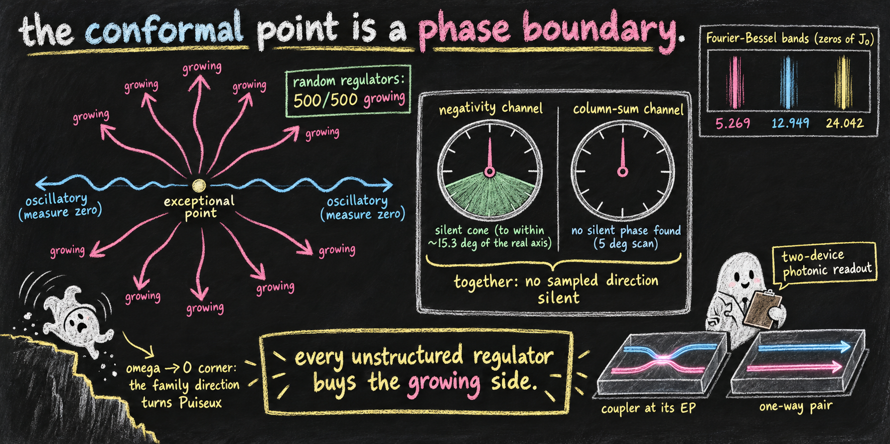

# The conformal point is a phase boundary

*unfolding directions, the sign map of the cascade divisor, and a two-channel photonic readout*



<sub>*Banner image: prompt written by Claude (Anthropic), rendered by ChatGPT (OpenAI).*</sub>

**Paper 6 of the [Indivisible Ghosts program](https://github.com/embeddetech/ghosts-program).** Jonathan Torkelson (2026).

**[Read the paper (PDF)](unfolded-ghosts-paper.pdf)** · LaTeX source in [`paper/`](paper/)

> **Status: working draft.** This manuscript is under the program's release-gate audit and is still being revised. It has not been peer reviewed. Read it accordingly; corrections land here as they are made.

## Abstract

The equal-frequency Pais–Uhlenbeck point—the per-mode kinematics of conformal gravity—is an exceptional point (EP), and this paper treats it as what an exceptional point is: a phase boundary. We classify every deformation of the theory by two data: the *kind* of unfolding direction (family-parameter detunings split the degenerate pair linearly; generic matrix perturbations split by Puiseux $`\sqrt\epsilon`$) and its *phase*, which decides oscillatory versus growing dynamics. On this map the oscillatory set is the punctured real axis ($`\Delta\neq0`$) of the family directions (while $`\omega_2^2`$ stays positive) and, the ray $`\varphi=0`$ (the single-entry-model reference direction, resolved to within $`O(\epsilon)`$) of the generic ones—measure zero (in the complex plane) either way (the family real axis by the analytic law; the generic ray by the exact Puiseux eigenvalues, from which growth with probability one follows for any absolutely continuous phase law (unstructured, traceless/phase-only regulators; fully generic noise still gives probability $`\to1`$, at rate $`1-O(\sqrt\epsilon)`$ for phase densities bounded near the band)—corroborated by random-phase perturbations landing on the growing side in $`500/500`$ draws at $`\epsilon=10^{-8}`$), so any *unstructured* regulator of the pure theory buys the growing side. Real-symplectic (structure-preserving) regulators are the sole exception—the characteristic polynomial stays even and real, so its discriminant sign splits perturbation directions into two *open* half-spaces, an oscillatory band and a growing one, and which side is bought then has probability strictly between $`0`$ and $`1`$ (developed below). The known deformations take their places: an Einstein term unfolds on the real axis (Stelle, oscillatory, dictionary cost $`2/\delta`$); the Donoghue–Menezes loop width tilts the approach ray by a fixed angle without imposing a detuning floor on the approach to the exceptional line; and the Ilhan–Kovner “ghost-turned tachyon” blowup of conformal gravity’s $`k=0`$ sector is the corner case $`\omega\to0`$, where the family direction itself turns Puiseux—their finite-time singularity sits on the corner’s imaginary-split unfolding (the $`\varphi=\pi`$ direction, where the detuned $`\omega_2^2<0`$); their blowup is reproduced here with no free parameters, while the map’s frozen-mode rate $`(\sqrt3/2)\gamma_b`$ is the rate their equations imply once their effective detuning is ingested. The boundary is then shown to be readable at the level of the theory’s stochastic (beable) representation: for cascade (triangular) processes we prove the divisor of the process is triangular with a per-bond sign law; that within Jordan cascades the pure conditional-mass-creation mechanism of the companion paper is strictly a property of the minimal block—for Jordan blocks of size $`k\ge3`$ the divisor generator has entries of *both* signs, in an exactly alternating pattern given by the Rayleigh sums of the zeros of the Bessel function $`J_0`$. At finite steps a dominant-pole argument—asymptotic, with numerically computed window edges, below the strength of the theorems—locates the divisor’s negative windows on Fourier–Bessel bands with edges at $`(j_{0,n}/j_{0,1})^2`$. Real detuning brings negativity back at the per-bond first-return length $`\pi/|\delta_i|`$; for splits in the closed upper half-plane the recurrence is paced by the *real part* of the split, while the negativity-free directions comprise the $`+\mathrm{i}`$ ray, the EP, and a computed silent cone centered on the $`-\mathrm{i}`$ ray whose sharp thresholds reach to within $`{\approx}15.3^\circ`$ of the real axis, from below (silent split phases $`{\approx}195.3^\circ`$–$`344.7^\circ`$; thresholds located to $`10^{-3}`$ degrees, cone interior sampled, in the text): the negativity channel is a spectrometer for the magnitude of the real part of the split, with a known silent sector. The divisor’s second diagnostic—the column-sum (conditional-mass-creation) channel, stated relative to the minimal contraction normalization defined in the text—fires at every sampled direction (a $`5^\circ`$ scan of the full circle finds no silent phase) and its onset, at known $`|\delta|`$, resolves the growing from the decaying imaginary ray (relative growth of the fed level, under the symmetric split convention fixed in the text)—a sign the negativity channel cannot see; and the $`\omega\to0`$ corner, being a size-4 Jordan block rather than a bond, is negativity-bearing by the $`k\ge3`$ theorem at the corner itself and, computationally, at every sampled unfolding direction. The two channels together leave no sampled direction silent, bond by bond. A two-device photonic extension of our measurement proposal (a coupler *at* its EP, and a dissipatively-coupled unidirectional pair) would measure the mechanism fingerprint and the direction spectroscopy on capabilities demonstrated in the platform family, one coupling transfer priced into the device error budget. All results are tree-level mode kinematics, stated for the minimal cell and its finite stackings.

## Reproducing the results

Each script is standalone Python (NumPy/SciPy) and prints its controls inline. The paper's *Code availability* section maps scripts to results.

```
pip install numpy scipy
python scripts/p6_cm_signs.py
```

| Script |
|---|
| [`p6_cm_signs.py`](scripts/p6_cm_signs.py) |
| [`p6_d4_device.py`](scripts/p6_d4_device.py) |
| [`p6_divisor_dxd.py`](scripts/p6_divisor_dxd.py) |
| [`p6_divisor_gate.py`](scripts/p6_divisor_gate.py) |
| [`p6_divisor_theorem.py`](scripts/p6_divisor_theorem.py) |
| [`p6_m2_channel.py`](scripts/p6_m2_channel.py) |
| [`p6_unfolding_sweep.py`](scripts/p6_unfolding_sweep.py) |

## Audit trail and provenance

This manuscript is an experiment in AI-conducted research: the work was carried out by large language models (Claude, Anthropic), directed and reviewed by the author. The paper's provenance statement says who did what. Nothing here should be taken on trust.

- The audit process: [`AUDIT.md`](AUDIT.md)
- Pass-by-pass audit ledger: [`histories/paper6-history.md`](histories/paper6-history.md)
- The full research notebook, the originating conversation, and every companion paper: the [program hub](https://github.com/embeddetech/ghosts-program)

## License

MIT — see [`LICENSE`](LICENSE).
